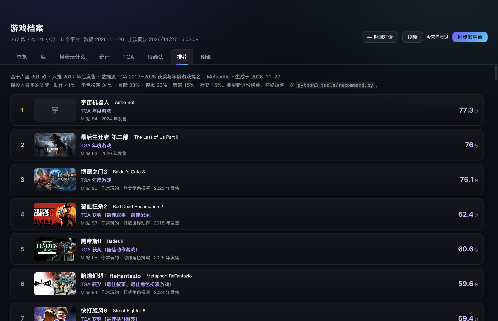

# 游戏档案 · dsh-game-archive

[](LICENSE)

把 **Steam / PSN / Switch / Xbox / Epic** 五个平台的游戏记录抓成一份自己的档案：画廊式浏览、状态机、评分短评、TGA 陈列室、年度回顾、库价值，还有「该接着玩什么」的排单。

一个 [DeepSeek Harness](https://github.com/deepseek-ai) 的插件（Host 提供接口，Client 提供界面），纯本地运行，数据存在你自己机器上。



## 安装

需要 DSH（DeepSeek Harness）已经能跑起来，机器上有 Python 3.8+。

```bash
git clone https://github.com/<you>/dsh-game-archive.git
# 然后在 DSH 里用 plugin_manager 的 install_bundle 指向这个目录（绝对路径）
```

装完重启 DSH，左栏会多一个「游戏档案」图标。

## 配置

第一次启动会在数据目录生成这些文件，**账号信息写在 `accounts.json`**（不含账号也能手动跑 `tools/sync.py --steam-id ...`）：

```json
{
  "steam_id": "你的 Steam 自定义网址后缀",
  "psn_id": "PSN 在线 ID",
  "xbox_xuid": "16 位 xuid",
  "switch_player": "SW-xxxx-xxxx-xxxx",
  "heybox_user_id": "小黑盒 user_id"
}
```

同步靠一个开了调试端口的浏览器（脚本自己连 CDP，不用装驱动）：

```bash
# 先起一个带调试端口的 Chrome，并在里面登录好 Steam / 小黑盒 / Epic
python3 tools/sync.py --out ~/Documents/游戏档案 --port 9333
```

## 数据从哪来

| 平台 | 拿什么 | 怎么拿 |
|---|---|---|
| Steam | 全部游戏、时长、成就 | 登录态下解析 `/id/<你>/games/?tab=all` 的 DOM |
| PSN / Switch / Xbox | 时长、奖杯/成就 | 小黑盒的分享页接口（要登录态；签名 URL 每次现签） |
| Epic | 订单（买了/白嫖了什么、花了多少） | `ajaxGetOrderHistory` 翻页；Epic 不给时长 |
| 补充字段 | 发售日 / M 站分 / 类型 / 原价 | Steam `appdetails`、Metacritic 前端接口、Wikipedia |

**没有任何数据上传到别处**，全部落在本地 `records.json` / `manual.json` / `enrichment.json`。

## 一点说明

- 只有「机器能证实」的状态才自动判定（没碰过 / 100% / 30 天内开过），**通关和弃坑必须你自己点**——完成度 97% 也可能是没全收集。
- 时长不准的地方会标出来：Switch 用小任天堂 App 的数字覆盖，Epic 天生没有时长。
- 白嫖来的付费游戏按**原价**计入库价值（Epic 每周免费也是资产），只有真·0 元又没怎么玩的 F2P 会被折起来。

---

## 它长什么样

左栏多一个图标，点开是一整页：

- **总览** — 总时长、款数、真开过的、TGA 获奖数、还没碰过；平台时长条形；**库价值**（点开分平台/类型/状态三张表）；
  **状态分布按钮可点**，点一下直接跳到「库」并筛好；**最常玩**与**最近在玩**各 24 款，默认只显示前 6，展开状态会记住。
- **库** — 网格 / 列表两种。搜索（多关键词空格分开）、平台/状态筛选、只看 TGA、八种排序（默认**按发售时间从新到旧**）。
  卡片右下补一行人话：发售年月 + M 站分。
- **接着玩什么** — 回坑推荐：一行一款，**不截断**。候选条件=玩够 5 小时 + 有奖杯/成就进度 + 没通关/没白金 + 至少两周没动；
  分数 = 时长(26) + 进度(30) + M 站口碑(22) + TGA 奖项(22) + 荒置时长(6)，每行附一句回坑理由。
- **统计** — 按「最后游玩年份」的时长柱状图 + 年度表格（补录过的月份会摊进对应年份）。「当年通关」含白金——白金就是通关加全成就，不重复计数。
- **TGA** — 历年 TGA 陈列室（2014–2025），按年切；左获奖（封面大图）右提名，库里有的标「我玩过」。
  角色扮演、玩家之声、持续运营、社区支持、格斗、家庭、模拟策略、体育竞速、VR/AR、多人、独立、独立首秀、影响力）；
  演出、移动、电竞、最受期待、无障碍这几类不显示，卡片上的 TGA 徽章也只数这 21 类。
- **推荐** — 一份**不自动更新**的推荐榜：候选只取 2017 年起的 TGA 获奖 + 年度游戏提名，剔掉库里已有的，
  按「TGA 档次 40 + M 站口碑 35 + 类型契合度 25」排序（契合度按你各类型的**投入小时占比**算）。
  要更新就手动跑 `python3 tools/recommend.py`（加 `--no-mc` 几秒出结果，不联网查 M 站）。
- **明细** — 一张能直接改的表：中文名 / 英文名 / 发售日 / M 站分 / 类型 / 发售价+币种。
  改一格存一格（写 `manual.json`，优先级最高、不会被自动同步覆盖），清空即恢复自动值。
  默认只列「还缺信息」的，可搜、可按平台筛。
- **待确认** — 状态拿不准的点一下定下来；时间拿不准的用「年 + 月」下拉填起止月，带「整年」「+1 月」快捷键。
- **详情抽屉** — 改状态（手动状态优先于自动判定）、打 1–10 分、写短评、恢复自动、从档案隐藏；顶部补发售/M 站/类型/原价。


## 状态是怎么判的

六档，机器的只管能证实的，人的判断优先且永久：

| 状态 | 谁决定 | 规则 |
|---|---|---|
| 还没碰过 backlog | 自动 | 游玩时长 < 0.1 小时 |
| 白金 platinum | 自动 | 成就/奖杯完成度 **100%** |
| 正在玩 playing | 自动 | 最后游玩在 **30 天内** |
| 已荒废 shelved | 自动 | 玩过、超 30 天没动（显示成「已荒废 3.4 年」这种；没日期的写「日期不明」） |
| 通关 finished | **只手动** | 完成度不等于通关：完到 97% 也可能是没全收集，机器不替你定 |
| 弃坑 dropped | **只手动** | 机器不猜「你不想玩了」 |

手动状态一旦设定就压过自动判定；详情抽屉里「恢复自动状态」可以撤。抽屉底部会写清当前这个状态是机器判的还是你标的。

## TGA 标记

奖项按三档配色，卡片边框 / 角标 / 奖项页三处一致：

| 档 | 什么情况 | 长什么样 |
|---|---|---|
| 金 | 拿过**年度游戏**（Game of the Year） | 金色描边 + `★ 年度游戏 ×N` |
| 银 | 拿过其他 TGA 奖 | 银色角标 `★ TGA ×N` |
| 铜 | 只是**年度游戏提名** | 铜色描边 + `★ 提名` |

- 名单在 `data/awards.json`（哪年获了什么奖）＋ `data/tga-history.json`（历年全部获奖与提名）。
- 这两个都是插件自带的策展数据，**每次启动都由插件内的版本覆盖数据目录**，改了立刻生效、不用重新同步。

## 待确认（校对台）

「待确认」页把两类拿不准的摊出来，一次点完：

1. **状态拿不准** —— 每行四个键：`弃坑` / `已荒废` / `通关` / `白金`。候选＝完成度 ≥60%、或投入 ≥10 小时、或没有日期的「已荒废」。按投入时长排序，先列最多的 80 款。
2. **时间拿不准** —— 只知道年份、或完全没有日期的游戏（Switch 基本全在这、Epic 没有时长所以不列）。填一个起止月，时长按月份**平均摊开**：
   - 例：585 小时填 2021-03 → 2021-06，就是每月 146.25 小时；
   - 月度分布图与年度回顾立刻按这个算；
   - 补录过的游戏用「末月」当最后游玩时间，所以状态会自动从「时间不明」变成「荒着/在玩」。

补录用的是 `userdata.json` 里的 `months: {from, to}`，同步不会覆盖。

## 库里补的字段 & 库价值

每款游戏尽量补齐四个字段，全部来自公开接口，拿不到的留空、界面显示「—」，**不编数字**：

| 字段 | 来源 |
|---|---|
| 发售时间 `release` | Steam `appdetails` 的 `release_date`（国区口径） |
| M 站评分 `metacritic` | 同上，`metacritic.score`（没有就是 `—`） |
| 游戏类型 `genre` | 同上，`genres` 拼成「动作 / 角色扮演」 |
| 发售价 `price` | 同上，`price_overview` 的原价+现价+折扣；免费游戏记 `free` |

生成器是 `tools/enrich.py`，产物 `enrichment.json`：

```bash
python3 tools/enrich.py --out "$HOME/Documents/游戏档案"            # 只补缺的
python3 tools/enrich.py --out ... --force            # 全部重抓
python3 tools/enrich.py --out ... --only "艾尔登法环,Dota 2"
```

它先按封面里的 appid 认，认不出就按名字搜 Steam（相似度 ≥ 0.62 才认），失败不覆盖旧值。

**库价值**在总览页：按原价合计（分币种，目前全是人民币），另给「白送的那部分原价」
（Epic 免费领取、真免费游戏）与「按现价估算」。数字对不上或没价格的一律显示 `—`，不猜。

## 数据放哪

默认 `~/Documents/deepseek-harness/work/游戏档案/`，可用插件 config 的 `dataDir` 或环境变量
`DSH_GAME_ARCHIVE_DIR` 改。里面三件套，职责严格分开：

| 文件 | 谁写 | 内容 |
|---|---|---|
| `records.json` | **同步**写 | 抓回来的原始记录：名称、平台、时长、完成度、最后游玩、封面 |
| `userdata.json` | **你**写 | 状态 / 评分 / 短评 / 标签 / 隐藏。同步永远不碰它 |
| `awards.json` | 手改 | TGA 名单，改了立刻生效，不用重新同步 |
| `switch-override.json` | 手改 | 任天堂官方时长覆盖小黑盒（小黑盒 Switch 计时偏低） |
| `enrichment.json` | `enrich.py` 写 | 发售时间 / M 站评分 / 类型 / 发售价（按 id） |
| `cover-override.json` | `covers.py` 写 | 缺封面的补图（名字 → {url, fit}；`fit: contain` 表示竖版盒图） |
| `tga-history.json` | 插件自带 | 2014–2025 每年全部 TGA 奖项的获奖与提名 |
| `tga-alias.json` | `build_tga_alias.py` 写 | 英文名单 → 中文名对照，用来在陈列室里标「我库里有」 |
| `name-cn.json` | 手写 | 手动校订的中文名（英文名 → 中文名）。Steam 官方只给有中文本地化的 24 个，剩下的靠这张表，优先于自动抓的 |
| `exclude.json` | 手写 | 「不算游戏」的名单（如 Wallpaper Engine 壁纸工具，Steam 自己也标成 game），按平台列名字，加载时剔掉 |
| `tga-media.json` | `tga_media.py` 写 | 陈列室用的中文名 + 封面（785 条，维基/Steam 双源；查不到标的 `skip`，不再重试） |
| `sync-state.json` | 同步写 | 上次同步时间与日志尾巴 |

## 一键同步怎么跑

同步借的是**你自己已经登录好的 Chrome**，不是另开一个无头浏览器——所以登录态、二次验证都
不用你重新过一遍。

1. 先用调试端口起 Chrome（一次就行，之后一直开着）：

   ```bash
   "/Applications/Google Chrome.app/Contents/MacOS/Google Chrome" \
     --remote-debugging-port=9333 --user-data-dir="$HOME/.dsh/chrome-archive"
   ```

2. 在这个 Chrome 里登好：`steamcommunity.com`、`web.xiaoheihe.cn`（小黑盒，管 PSN/Switch/Xbox）、
   `accounts.epicgames.com`。

3. 点页面右上角「同步五平台」。或者命令行：

   ```bash
   python3 tools/sync.py --port 9333 --out "$HOME/Documents/游戏档案"
   ```

参数：`--only steam,psn` / `--skip epic` / `--steam-id` / `--psn-id` / `--xbox-xuid`。

同步是**按平台隔离**的：某个平台挂了（登录过期之类）其它平台照写，页面会把失败原因列出来。

## 为什么不做后台定时

- 小黑盒的接口签名（hkey）是**每次打开页面现签**的，脱离页面就没有有效签名。
- Xbox 那条链路的令牌一天就过期。

所以设计成「你想更新的时候点一下」，而不是假装能自动。

## 给 agent 用的两个工具

- `game_archive_query` — 按平台 / 状态 / 关键词 / 最少时长 / 只看获奖筛选，返回条目。
- `game_archive_stats` — 总览：平台分布、状态分布、年度、该接着玩。

问「我最近该玩什么」「我买了没碰的有多少」直接调工具，不用读文件。

## 结构

```
index.js        Host：种子、合并、状态机、封面代理、/data /edit /sync 路由、两个工具
client.js       前端：整页六视图 + 详情抽屉，样式全内联（.ga- 前缀）
tools/sync.py               同步脚本，只用标准库（自带最小 WebSocket 客户端，不用 pip 装东西）
tools/enrich.py             补发售时间 / M 站 / 类型 / 发售价
tools/covers.py             给缺封面的补图（Steam header → Wikipedia 盒图）
tools/build_tga_history.py  抓 Wikipedia 生成历年 TGA 获奖/提名
tools/build_tga_alias.py    生成 TGA 英文名 → 中文名对照
tools/tga_media.py          陈列室的中文名 + 封面（维基 langlinks / pageimages 批量 + Steam 兜底）
tools/epic_price.py         给白嫖来的游戏标真实原价（Epic→Steam 商店价，只认名字规范化后完全一致的）
tools/export_platform.py    按平台导明细（默认 PSN+Switch）：python3 tools/export_platform.py --platforms PSN,Switch
tools/meta_score.py         M 站评分 + 发售日 + 类型（打 backend.metacritic.com 前端接口，按名字模糊匹配）
data/                       种子数据：records / awards / switch-override / tga-history / tga-alias / cover-override
locale/         zh / en
```

## 已知口径

- **Steam**：页面 DOM 解析，`TOTAL PLAYED` 的 hours / minutes 都认；成就完成率来自页面文本。
- **PSN / Xbox**：小黑盒接口，有完整时长与奖杯/成就数。
- **Switch**：小黑盒计时系统性偏低，用 `switch-override.json` 以任天堂 App 的数字覆盖。
- **Epic**：只有订单接口（`ajaxGetOrderHistory`），所以有「买了什么、什么时候、多少钱」，**没有时长**。
- 年度回顾按「最后游玩年份」归档，一款游戏只算进最后一次，因此是近似值。

### 什么不算「游戏」

`data/exclude.json` 管两件事，改完重启生效：

- `tools`：工具 / 补丁 / 编辑器 / SDK 这类被平台标成 game 的东西（SKSE、Wallpaper Engine、Squad Mod SDK…），按 平台 → 名字 精确排除。
- `lowfree`：`{ "enabled": true, "maxHours": 2 }` —— 时长不到 2 小时 **且 原价就是 0** 的（纯 F2P 网游、只打开看一眼的）自动隐藏。
  **白嫖来的付费游戏不算免费**：Epic 每周免费、PSN 会免拿到的，按游戏本身的原价计入库价值，原价 > 0 就一律保留。价格未知的也保留，不当免费处理。

## 许可

MIT。游戏名、封面、评分等数据版权归各自权利人；这里只做个人记录的整理。
